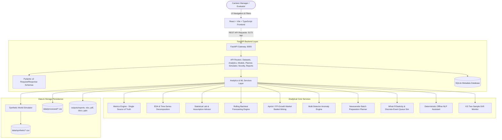
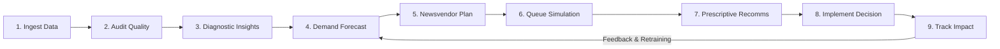
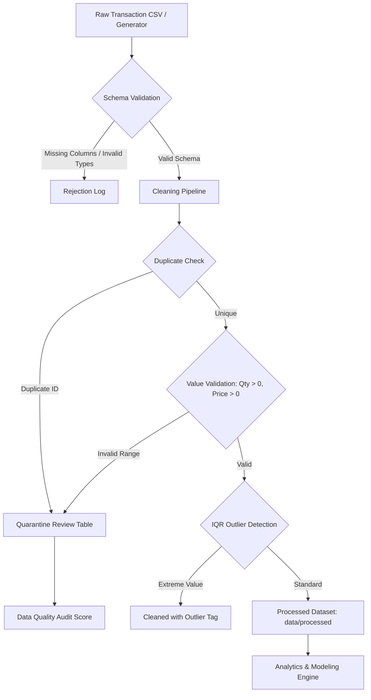
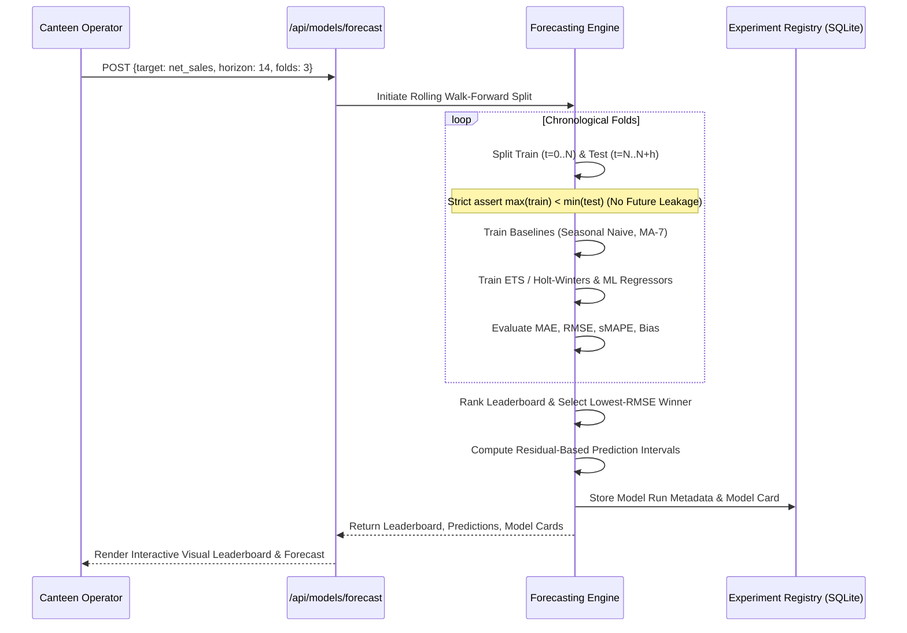

# CanteenIQ System Architecture & Data Flow Specification

## 1. High-Level Architecture Overview

The CanteenIQ ecosystem is built around an offline, decoupled client-server architecture designed for zero operating costs, full determinism, and strict local privacy.

---

## 2. The Closed Decision Loop

CanteenIQ implements an end-to-end feedback loop connecting raw POS transactions directly into operational interventions.

---

## 3. Data Lineage and Cleaning Architecture

---

## 4. Forecasting Studio: No-Leakage Backtest Architecture

